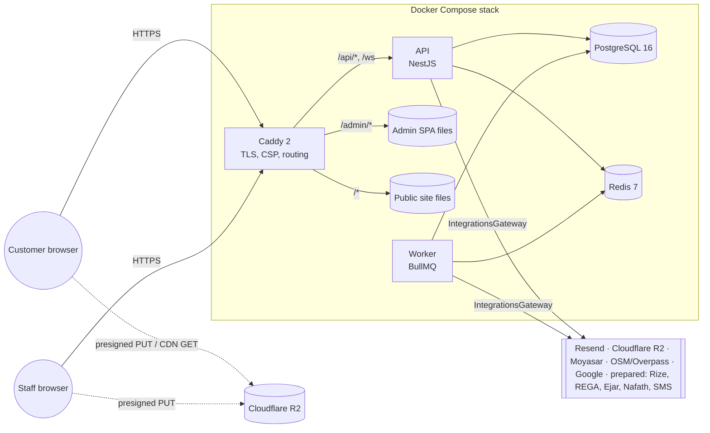
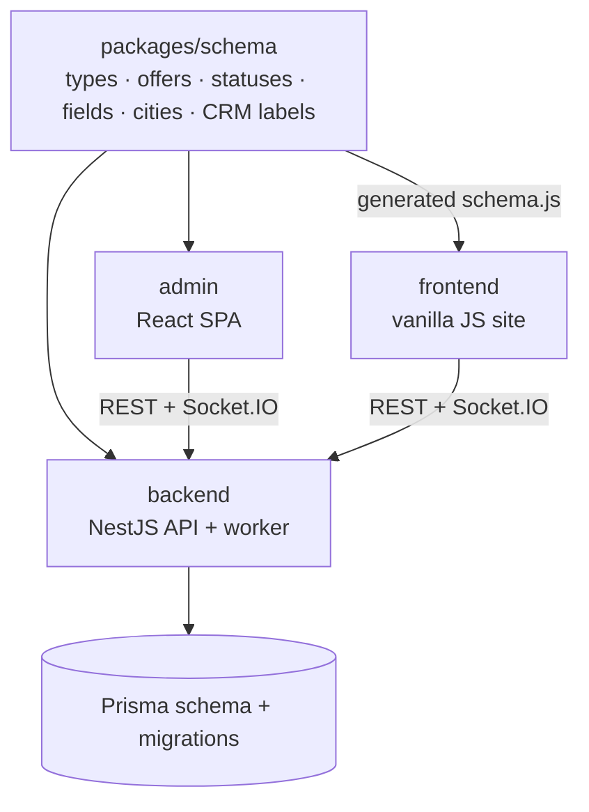
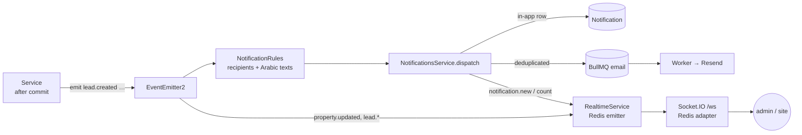
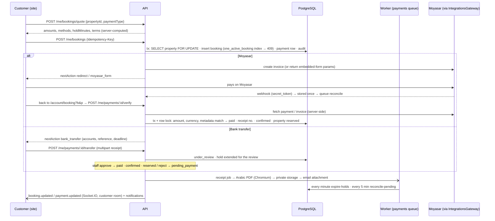

# Architecture

## 1. System context



- One origin for everything (site, admin, API, WebSocket) → no CORS, cookies scoped to `/api/v1/auth`.
- Only Caddy publishes ports. PostgreSQL and Redis are on an internal network.
- The API and the worker are the **same image** (`node dist/main.js` / `node dist/worker.js`).
- Every third-party call goes through `IntegrationsGateway` (except the map tiles and Moyasar's card
  form, which run in the browser by design).

## 2. Containers

| Service | Image / command | Responsibility |
|---|---|---|
| `caddy` | caddy:2.8 | TLS, security headers, CSP per area, clean URLs, `/property/{id}-{slug}` and `/account` rewrites, private-file blocking, 404 page |
| `api` | `api` target, `node dist/main.js` | REST `/api/v1`, Socket.IO `/ws`, webhooks |
| `worker` | same image, `node dist/worker.js` | Email delivery, image processing, integration health, CRM jobs (reminders, digests, PDPL anonymisation) |
| `migrate` | same image (one-off) | `prisma migrate deploy` + owner seed before api/worker start |
| `postgres` | postgres:16 | System of record |
| `redis` | redis:7 (password) | Cache, rate limits, token revocation, idempotency keys, BullMQ queues, Socket.IO adapter |
| `frontend` / `admin` | static targets | Files served by Caddy |

## 3. Code layout and dependencies



`packages/schema` is the single source of truth for property types, offers, statuses, fields, cities
and nearby categories: backend validation (`buildSpecsZod`), the admin editor (`fieldsFor`) and the
public site (`frontend/assets/js/schema.js`, generated) all derive from it.

## 4. Request lifecycle (API)

1. **Middleware**: correlation id (`X-Correlation-Id`, echoed in errors and outgoing integration calls),
   JSON shape guard (depth/size), body limits (JSON 1 MB).
2. **Guards** (global, in order): `RateLimitGuard` (Redis sliding window; default 120/min/IP for public
   GETs) → `CsrfGuard` (routes marked `@RequireCsrfHeader`) → `AuthGuard` (default deny: a route must
   declare `@Public`, `@Staff(perms…)`, `@Customer` or `@Authenticated`; `@RecentAuth` adds the
   10-minute re-authentication window).
3. **Validation**: `ZodValidationPipe` with strict DTOs (`createZodDto`); unknown keys rejected.
4. **Service**: row-level scopes from `AccessScopeService` (agents: "own"); writes inside
   `prisma.$transaction` together with `AuditService.record(…, tx)`.
5. **After commit**: domain event via `EventEmitter2` → notification rules, realtime pushes, cache
   invalidation (`invalidatePublic()` runs **before** the event so listeners read fresh data).
6. **Errors**: `AllExceptionsFilter` → `{ error: { code, message (Arabic), details, correlationId } }`;
   internal details are never returned or logged with secrets (pino redaction).

## 5. Authentication and sessions

```mermaid
sequenceDiagram
  participant B as Browser
  participant A as API
  participant R as Redis
  participant D as PostgreSQL
  B->>A: POST /auth/staff/login (email, password)
  A->>D: argon2id verify, lockout counters
  A-->>B: challenge (TOTP / password change / 2FA setup)
  B->>A: POST /auth/staff/2fa (code)
  A->>D: refresh token (hash only) in a new family
  A-->>B: access JWT (15 min, body) + refresh cookie (httpOnly, Secure, SameSite=Lax, path /api/v1/auth)
  B->>A: API calls with Authorization: Bearer
  A->>R: is the token older than the subject's revocation time?
  B->>A: POST /auth/refresh (cookie + X-Requested-With: nx)
  A->>D: rotate (old token revoked; reuse after 30 s grace ⇒ whole family revoked + security.session_revoked)
```

- Staff: argon2id, lockout after 10 failures, TOTP mandatory for owner/admin/finance, 10 hashed
  recovery codes, invites (72 h), reset links (30 min).
- Customers: passwordless email OTP (6 digits, 10 min, 5 attempts), PDPL consent at registration,
  optional password.
- Access tokens: HS256 15 min; refresh tokens: opaque random, stored as keyed hashes, rotated on every
  use, family revocation on reuse. A concurrent-rotation grace window of 30 s returns the same successor
  (stored encrypted in Redis) so parallel tabs do not log the user out.
- Revocation (logout everywhere, block, password reset) sets a per-subject "minimum issued-at" in Redis
  and disconnects that subject's sockets.

## 6. Events, notifications and realtime



- Channels per recipient = admin defaults (`settings.notifications.channels`) overridden by the
  recipient's preferences; *locked* events (bookings, payments, security) cannot be switched off.
- Emails are deduplicated per `event:entity:recipient` for 24 h; non-transactional emails link to the
  preferences page.
- Realtime payloads are minimal (ids, status); clients refetch details through the API, so permission
  checks always apply. Event list: [reference/events.md](./reference/events.md).

## 7. Media pipeline

Admin requests a presigned PUT (type/size bound) → browser uploads to R2 → `complete` queues a media
job → worker downloads, validates, strips EXIF, renders 480/960/1920 px JPEG + WebP variants with
sharp, stores them in the public media bucket → listing shows CDN URLs. Demo listings use static
images under `/assets/img`.

## 8. Booking and payment flow



Rules: the browser never decides an amount or a status; webhooks only queue a reconcile; every state
change goes through `BookingTransitions` (audit + `PropertyStatusHistory` + events after commit);
receipt numbers `R-YYYY-NNNNNN`, booking numbers `B-YYYY-NNNNNN`. Details:
[backend.md §4](./backend.md#4-domain-notes), [integrations.md](./integrations.md), docs/04.

## 9. Data ownership

| Data | Where | Notes |
|---|---|---|
| Listings, CRM, customers, bookings, audit | PostgreSQL | Money = halalas (`BigInt`); see [reference/data-model.md](./reference/data-model.md) |
| Settings (13 sections) | PostgreSQL `SettingsSection` + Redis cache | Zod-validated, audited |
| Provider credentials | PostgreSQL `Integration.secretsEnc` | AES-256-GCM, write-only, masked in the UI |
| Sessions | PostgreSQL `RefreshToken` (hashes) + Redis (revocation, grace) | |
| Photos and receipts | Cloudflare R2 | Media bucket public via CDN; uploads bucket private (signed URLs) |
| Caches, rate limits, idempotency, queues | Redis | Losing Redis loses no business data |
