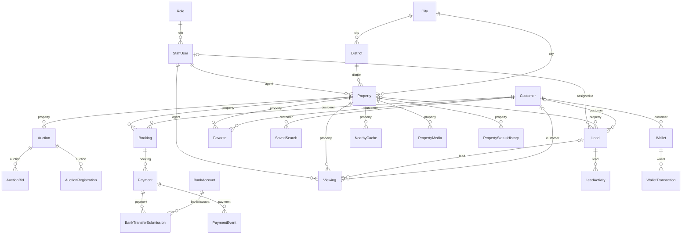

# Data model

> **Generated** by `pnpm run docs` from the source code — do not edit by hand.
> Regenerate after any change; CI runs `pnpm docs:check`.

Source of truth: `backend/prisma/schema.prisma` (from docs/01) and its migrations. Money columns are
halalas (`BigInt`). Extra SQL in the init migration: `pg_trgm`/`unaccent` search indexes, the partial
unique index `one_active_booking` (one active booking per property) and CHECK constraints.

## Enums

| Enum | Values |
|---|---|
| `CustomerStatus` | `active` `blocked` `deleted` |
| `SubjectType` | `staff` `customer` |
| `OtpChannel` | `email` `sms` |
| `OtpPurpose` | `login` `verify_email` `verify_phone` `reset_password` `staff_2fa_email` |
| `PropertyOffer` | `sale` `rent` `investment` |
| `PropertyStatus` | `available` `negotiation` `reserved` `sold` `rented` |
| `RentPeriod` | `yearly` `monthly` `daily` |
| `ListingVisibility` | `draft` `published` `archived` |
| `AdLicenseCheck` | `unknown` `valid` `expiring` `expired` `invalid` |
| `MediaKind` | `photo` `floor_plan` `document` `video_url` |
| `MediaStatus` | `processing` `ready` `failed` |
| `LeadType` | `viewing` `waitlist` `buy` `rent` `list` `invest` `manage` `contact` |
| `LeadStage` | `new` `contacted` `viewing` `negotiation` `won` `lost` |
| `LeadSource` | `website` `whatsapp` `phone` `walk_in` `admin` |
| `LeadActivityType` | `note` `call` `whatsapp` `email` `stage_change` `assignment` `viewing` `booking` `system` |
| `ViewingStatus` | `requested` `confirmed` `completed` `no_show` `cancelled` |
| `BookingStatus` | `pending_payment` `awaiting_transfer_review` `confirmed` `completed` `cancelled` `expired` `refunded` |
| `PaymentType` | `deposit` `full` |
| `PaymentMethod` | `moyasar` `bank_transfer` `rize` |
| `PaymentStatus` | `initiated` `pending` `paid` `failed` `under_review` `rejected` `cancelled` `refunded` `partially_refunded` |
| `TransferStatus` | `submitted` `approved` `rejected` |
| `NotificationPriority` | `low` `normal` `high` |
| `EmailStatus` | `queued` `sent` `delivered` `bounced` `complained` `failed` |
| `IntegrationEnv` | `sandbox` `live` |
| `IntegrationHealth` | `unknown` `ok` `degraded` `down` |
| `AuctionStatus` | `draft` `scheduled` `live` `ended` `awarded` `cancelled` |
| `RegistrationStatus` | `pending` `approved` `rejected` |
| `GuaranteeType` | `wallet` `nafith` |
| `WalletTxType` | `topup` `hold` `release` `capture` `refund` `adjustment` |

## Models

### Role

| Field | Type | Notes |
|---|---|---|
| `id` | `String` | PK, default |
| `key` | `String` | unique |
| `nameAr` | `String` |  |
| `isSystem` | `Boolean` | default |
| `permissions` | `String` | list |
| `users` | `StaffUser` | list, relation |
| `createdAt` | `DateTime` | default |
| `updatedAt` | `DateTime` | updatedAt |

### StaffUser

| Field | Type | Notes |
|---|---|---|
| `id` | `String` | PK, default |
| `name` | `String` |  |
| `email` | `String` | unique |
| `phone` | `String` | optional |
| `whatsapp` | `String` | optional |
| `title` | `String` | optional |
| `falLicense` | `String` | optional |
| `avatarKey` | `String` | optional |
| `passwordHash` | `String` |  |
| `roleId` | `String` |  |
| `role` | `Role` | relation (roleId) |
| `isActive` | `Boolean` | default |
| `showOnWebsite` | `Boolean` | default |
| `totpSecretEnc` | `Bytes` | optional |
| `totpEnabled` | `Boolean` | default |
| `mustChangePassword` | `Boolean` | default |
| `totpRecoveryCodes` | `String` | list, default |
| `lastLoginAt` | `DateTime` | optional |
| `createdAt` | `DateTime` | default |
| `updatedAt` | `DateTime` | updatedAt |
| `deletedAt` | `DateTime` | optional |
| `properties` | `Property` | list, relation |
| `assignedLeads` | `Lead` | list, relation |
| `viewings` | `Viewing` | list, relation |

### Customer

| Field | Type | Notes |
|---|---|---|
| `id` | `String` | PK, default |
| `name` | `String` |  |
| `email` | `String` | unique, optional |
| `phone` | `String` | unique, optional |
| `passwordHash` | `String` | optional |
| `emailVerifiedAt` | `DateTime` | optional |
| `phoneVerifiedAt` | `DateTime` | optional |
| `nafathVerifiedAt` | `DateTime` | optional |
| `nationalIdHash` | `String` | optional |
| `nationalIdLast4` | `String` | optional |
| `status` | `CustomerStatus` | default |
| `marketingConsent` | `Boolean` | default |
| `consentAt` | `DateTime` | optional |
| `lastLoginAt` | `DateTime` | optional |
| `createdAt` | `DateTime` | default |
| `updatedAt` | `DateTime` | updatedAt |
| `deletedAt` | `DateTime` | optional |
| `favorites` | `Favorite` | list, relation |
| `savedSearches` | `SavedSearch` | list, relation |
| `leads` | `Lead` | list, relation |
| `viewings` | `Viewing` | list, relation |
| `bookings` | `Booking` | list, relation |
| `wallet` | `Wallet` | optional, relation |

### RefreshToken

| Field | Type | Notes |
|---|---|---|
| `id` | `String` | PK, default |
| `subjectType` | `SubjectType` |  |
| `subjectId` | `String` |  |
| `tokenHash` | `String` | unique |
| `family` | `String` |  |
| `userAgent` | `String` | optional |
| `ip` | `String` | optional |
| `expiresAt` | `DateTime` |  |
| `revokedAt` | `DateTime` | optional |
| `createdAt` | `DateTime` | default |

### OtpCode

| Field | Type | Notes |
|---|---|---|
| `id` | `String` | PK, default |
| `channel` | `OtpChannel` |  |
| `destination` | `String` |  |
| `purpose` | `OtpPurpose` |  |
| `codeHash` | `String` |  |
| `attempts` | `Int` | default |
| `expiresAt` | `DateTime` |  |
| `consumedAt` | `DateTime` | optional |
| `createdAt` | `DateTime` | default |

### City

| Field | Type | Notes |
|---|---|---|
| `id` | `String` | PK |
| `nameAr` | `String` |  |
| `lat` | `Decimal` |  |
| `lng` | `Decimal` |  |
| `sort` | `Int` | default |
| `isActive` | `Boolean` | default |
| `districts` | `District` | list, relation |
| `properties` | `Property` | list, relation |

### District

| Field | Type | Notes |
|---|---|---|
| `id` | `String` | PK, default |
| `cityId` | `String` |  |
| `city` | `City` | relation (cityId) |
| `nameAr` | `String` |  |
| `lat` | `Decimal` | optional |
| `lng` | `Decimal` | optional |
| `isActive` | `Boolean` | default |
| `properties` | `Property` | list, relation |

Composite unique: (cityId, nameAr)

### Property

| Field | Type | Notes |
|---|---|---|
| `id` | `Int` | PK, default |
| `code` | `String` | unique |
| `slug` | `String` |  |
| `type` | `String` |  |
| `offer` | `PropertyOffer` |  |
| `status` | `PropertyStatus` | default |
| `visibility` | `ListingVisibility` | default |
| `featured` | `Boolean` | default |
| `title` | `String` |  |
| `description` | `String` |  |
| `cityId` | `String` |  |
| `city` | `City` | relation (cityId) |
| `districtId` | `String` |  |
| `district` | `District` | relation (districtId) |
| `lat` | `Decimal` |  |
| `lng` | `Decimal` |  |
| `showExactLocation` | `Boolean` | default |
| `price` | `BigInt` |  |
| `rentPeriod` | `RentPeriod` | optional |
| `negotiable` | `Boolean` | default |
| `annualisedPrice` | `BigInt` |  |
| `pricePerMeter` | `BigInt` | optional |
| `area` | `Int` |  |
| `bedrooms` | `Int` | optional |
| `bathrooms` | `Int` | optional |
| `roi` | `Decimal` | optional |
| `specs` | `Json` |  |
| `adLicenseNo` | `String` |  |
| `falLicenseNo` | `String` |  |
| `licenseExpiry` | `DateTime` | optional |
| `adLicenseCheck` | `AdLicenseCheck` | default |
| `adLicenseCheckedAt` | `DateTime` | optional |
| `bookingEnabled` | `Boolean` | default |
| `paymentPolicy` | `Json` | optional |
| `seoTitle` | `String` | optional |
| `seoDescription` | `String` | optional |
| `focusKeyword` | `String` | optional |
| `keywords` | `String` | list |
| `ogImageKey` | `String` | optional |
| `noindex` | `Boolean` | default |
| `agentId` | `String` |  |
| `agent` | `StaffUser` | relation (agentId) |
| `createdById` | `String` |  |
| `updatedById` | `String` | optional |
| `publishedAt` | `DateTime` | optional |
| `viewCount` | `Int` | default |
| `createdAt` | `DateTime` | default |
| `updatedAt` | `DateTime` | updatedAt |
| `deletedAt` | `DateTime` | optional |
| `media` | `PropertyMedia` | list, relation |
| `statusHistory` | `PropertyStatusHistory` | list, relation |
| `favorites` | `Favorite` | list, relation |
| `leads` | `Lead` | list, relation |
| `viewings` | `Viewing` | list, relation |
| `bookings` | `Booking` | list, relation |
| `nearbyCache` | `NearbyCache` | list, relation |
| `auctions` | `Auction` | list, relation |

### PropertyMedia

| Field | Type | Notes |
|---|---|---|
| `id` | `String` | PK, default |
| `propertyId` | `Int` |  |
| `property` | `Property` | relation (propertyId) |
| `kind` | `MediaKind` | default |
| `originalKey` | `String` | optional |
| `variants` | `Json` | optional |
| `externalUrl` | `String` | optional |
| `width` | `Int` | optional |
| `height` | `Int` | optional |
| `altAr` | `String` | optional |
| `sort` | `Int` | default |
| `isCover` | `Boolean` | default |
| `status` | `MediaStatus` | default |
| `createdAt` | `DateTime` | default |

### PropertyStatusHistory

| Field | Type | Notes |
|---|---|---|
| `id` | `String` | PK, default |
| `propertyId` | `Int` |  |
| `property` | `Property` | relation (propertyId) |
| `from` | `PropertyStatus` |  |
| `to` | `PropertyStatus` |  |
| `reason` | `String` | optional |
| `bookingId` | `String` | optional |
| `actorType` | `String` |  |
| `actorId` | `String` | optional |
| `createdAt` | `DateTime` | default |

### NearbyCache

| Field | Type | Notes |
|---|---|---|
| `id` | `String` | PK, default |
| `propertyId` | `Int` |  |
| `property` | `Property` | relation (propertyId) |
| `provider` | `String` |  |
| `radius` | `Int` |  |
| `items` | `Json` |  |
| `fetchedAt` | `DateTime` | default |
| `expiresAt` | `DateTime` |  |

Composite unique: (propertyId, provider, radius)

### Favorite

| Field | Type | Notes |
|---|---|---|
| `customerId` | `String` |  |
| `propertyId` | `Int` |  |
| `customer` | `Customer` | relation (customerId) |
| `property` | `Property` | relation (propertyId) |
| `createdAt` | `DateTime` | default |

### SavedSearch

| Field | Type | Notes |
|---|---|---|
| `id` | `String` | PK, default |
| `customerId` | `String` |  |
| `customer` | `Customer` | relation (customerId) |
| `name` | `String` |  |
| `query` | `Json` |  |
| `alertEnabled` | `Boolean` | default |
| `lastNotifiedAt` | `DateTime` | optional |
| `createdAt` | `DateTime` | default |

### Lead

| Field | Type | Notes |
|---|---|---|
| `id` | `String` | PK, default |
| `number` | `String` | unique |
| `type` | `LeadType` |  |
| `stage` | `LeadStage` | default |
| `source` | `LeadSource` | default |
| `propertyId` | `Int` | optional |
| `property` | `Property` | optional, relation (propertyId) |
| `customerId` | `String` | optional |
| `customer` | `Customer` | optional, relation (customerId) |
| `name` | `String` |  |
| `phone` | `String` |  |
| `email` | `String` | optional |
| `cityId` | `String` | optional |
| `propertyType` | `String` | optional |
| `budget` | `BigInt` | optional |
| `message` | `String` | optional |
| `preferredDate` | `DateTime` | optional |
| `preferredSlot` | `String` | optional |
| `assignedToId` | `String` | optional |
| `assignedTo` | `StaffUser` | optional, relation (assignedToId) |
| `lostReason` | `String` | optional |
| `consent` | `Boolean` | default |
| `utm` | `Json` | optional |
| `meta` | `Json` | optional |
| `closedAt` | `DateTime` | optional |
| `createdAt` | `DateTime` | default |
| `updatedAt` | `DateTime` | updatedAt |
| `activities` | `LeadActivity` | list, relation |
| `viewings` | `Viewing` | list, relation |

### LeadActivity

| Field | Type | Notes |
|---|---|---|
| `id` | `String` | PK, default |
| `leadId` | `String` |  |
| `lead` | `Lead` | relation (leadId) |
| `type` | `LeadActivityType` |  |
| `body` | `String` | optional |
| `meta` | `Json` | optional |
| `actorId` | `String` | optional |
| `createdAt` | `DateTime` | default |

### Viewing

| Field | Type | Notes |
|---|---|---|
| `id` | `String` | PK, default |
| `propertyId` | `Int` |  |
| `property` | `Property` | relation (propertyId) |
| `leadId` | `String` | optional |
| `lead` | `Lead` | optional, relation (leadId) |
| `customerId` | `String` | optional |
| `customer` | `Customer` | optional, relation (customerId) |
| `agentId` | `String` |  |
| `agent` | `StaffUser` | relation (agentId) |
| `scheduledAt` | `DateTime` |  |
| `durationMin` | `Int` | default |
| `status` | `ViewingStatus` | default |
| `notes` | `String` | optional |
| `createdAt` | `DateTime` | default |
| `updatedAt` | `DateTime` | updatedAt |

### Booking

| Field | Type | Notes |
|---|---|---|
| `id` | `String` | PK, default |
| `number` | `String` | unique |
| `propertyId` | `Int` |  |
| `property` | `Property` | relation (propertyId) |
| `customerId` | `String` |  |
| `customer` | `Customer` | relation (customerId) |
| `offerSnapshot` | `PropertyOffer` |  |
| `priceSnapshot` | `BigInt` |  |
| `rentPeriodSnapshot` | `RentPeriod` | optional |
| `paymentType` | `PaymentType` |  |
| `paymentMethod` | `PaymentMethod` |  |
| `amountDue` | `BigInt` |  |
| `amountPaid` | `BigInt` | default |
| `status` | `BookingStatus` | default |
| `holdExpiresAt` | `DateTime` |  |
| `termsVersion` | `String` |  |
| `termsAcceptedAt` | `DateTime` |  |
| `customerNotes` | `String` | optional |
| `cancelReason` | `String` | optional |
| `confirmedAt` | `DateTime` | optional |
| `completedAt` | `DateTime` | optional |
| `cancelledAt` | `DateTime` | optional |
| `createdAt` | `DateTime` | default |
| `updatedAt` | `DateTime` | updatedAt |
| `payments` | `Payment` | list, relation |

### Payment

| Field | Type | Notes |
|---|---|---|
| `id` | `String` | PK, default |
| `bookingId` | `String` |  |
| `booking` | `Booking` | relation (bookingId) |
| `method` | `PaymentMethod` |  |
| `status` | `PaymentStatus` | default |
| `amount` | `BigInt` |  |
| `refundedAmount` | `BigInt` | default |
| `currency` | `String` | default |
| `idempotencyKey` | `String` | unique |
| `providerPaymentId` | `String` | unique, optional |
| `providerInvoiceId` | `String` | unique, optional |
| `providerStatus` | `String` | optional |
| `providerUrl` | `String` | optional |
| `providerPayload` | `Json` | optional |
| `receiptNumber` | `String` | unique, optional |
| `paidAt` | `DateTime` | optional |
| `failureReason` | `String` | optional |
| `createdAt` | `DateTime` | default |
| `updatedAt` | `DateTime` | updatedAt |
| `events` | `PaymentEvent` | list, relation |
| `transfer` | `BankTransferSubmission` | optional, relation |

### PaymentEvent

| Field | Type | Notes |
|---|---|---|
| `id` | `String` | PK, default |
| `paymentId` | `String` |  |
| `payment` | `Payment` | relation (paymentId) |
| `type` | `String` |  |
| `payload` | `Json` | optional |
| `createdAt` | `DateTime` | default |

### BankAccount

| Field | Type | Notes |
|---|---|---|
| `id` | `String` | PK, default |
| `bankName` | `String` |  |
| `beneficiaryName` | `String` |  |
| `iban` | `String` |  |
| `accountNumber` | `String` | optional |
| `swift` | `String` | optional |
| `isActive` | `Boolean` | default |
| `sort` | `Int` | default |
| `createdAt` | `DateTime` | default |
| `updatedAt` | `DateTime` | updatedAt |
| `submissions` | `BankTransferSubmission` | list, relation |

### BankTransferSubmission

| Field | Type | Notes |
|---|---|---|
| `id` | `String` | PK, default |
| `paymentId` | `String` | unique |
| `payment` | `Payment` | relation (paymentId) |
| `bankAccountId` | `String` |  |
| `bankAccount` | `BankAccount` | relation (bankAccountId) |
| `senderName` | `String` |  |
| `senderBank` | `String` |  |
| `transferReference` | `String` | optional |
| `transferredAt` | `DateTime` |  |
| `amount` | `BigInt` |  |
| `receiptKey` | `String` |  |
| `status` | `TransferStatus` | default |
| `reviewedById` | `String` | optional |
| `reviewedAt` | `DateTime` | optional |
| `rejectionReason` | `String` | optional |
| `createdAt` | `DateTime` | default |

### Notification

| Field | Type | Notes |
|---|---|---|
| `id` | `String` | PK, default |
| `recipientType` | `SubjectType` |  |
| `recipientId` | `String` |  |
| `eventKey` | `String` |  |
| `title` | `String` |  |
| `body` | `String` |  |
| `link` | `String` | optional |
| `data` | `Json` | optional |
| `priority` | `NotificationPriority` | default |
| `readAt` | `DateTime` | optional |
| `archivedAt` | `DateTime` | optional |
| `createdAt` | `DateTime` | default |

### NotificationPreference

| Field | Type | Notes |
|---|---|---|
| `recipientType` | `SubjectType` |  |
| `recipientId` | `String` |  |
| `eventKey` | `String` |  |
| `inApp` | `Boolean` | default |
| `email` | `Boolean` | default |
| `sms` | `Boolean` | default |

### EmailLog

| Field | Type | Notes |
|---|---|---|
| `id` | `String` | PK, default |
| `to` | `String` |  |
| `template` | `String` |  |
| `subject` | `String` |  |
| `resendId` | `String` | unique, optional |
| `status` | `EmailStatus` | default |
| `error` | `String` | optional |
| `relatedType` | `String` | optional |
| `relatedId` | `String` | optional |
| `createdAt` | `DateTime` | default |
| `updatedAt` | `DateTime` | updatedAt |

### SettingsSection

| Field | Type | Notes |
|---|---|---|
| `key` | `String` | PK |
| `value` | `Json` |  |
| `updatedById` | `String` | optional |
| `updatedAt` | `DateTime` | updatedAt |

### Integration

| Field | Type | Notes |
|---|---|---|
| `key` | `String` | PK |
| `category` | `String` |  |
| `enabled` | `Boolean` | default |
| `environment` | `IntegrationEnv` | default |
| `config` | `Json` | default |
| `secretsEnc` | `Bytes` | optional |
| `secretsHint` | `Json` | optional |
| `health` | `IntegrationHealth` | default |
| `healthCheckedAt` | `DateTime` | optional |
| `lastError` | `String` | optional |
| `updatedById` | `String` | optional |
| `updatedAt` | `DateTime` | updatedAt |

### IntegrationCallLog

| Field | Type | Notes |
|---|---|---|
| `id` | `String` | PK, default |
| `integrationKey` | `String` |  |
| `operation` | `String` |  |
| `success` | `Boolean` |  |
| `httpStatus` | `Int` | optional |
| `latencyMs` | `Int` |  |
| `correlationId` | `String` |  |
| `request` | `Json` | optional |
| `response` | `Json` | optional |
| `error` | `String` | optional |
| `createdAt` | `DateTime` | default |

### WebhookEvent

| Field | Type | Notes |
|---|---|---|
| `id` | `String` | PK, default |
| `provider` | `String` |  |
| `externalId` | `String` |  |
| `type` | `String` |  |
| `payload` | `Json` |  |
| `signatureValid` | `Boolean` |  |
| `processedAt` | `DateTime` | optional |
| `error` | `String` | optional |
| `createdAt` | `DateTime` | default |

Composite unique: (provider, externalId)

### AuditLog

| Field | Type | Notes |
|---|---|---|
| `id` | `String` | PK, default |
| `actorType` | `String` |  |
| `actorId` | `String` | optional |
| `action` | `String` |  |
| `entityType` | `String` |  |
| `entityId` | `String` |  |
| `before` | `Json` | optional |
| `after` | `Json` | optional |
| `ip` | `String` | optional |
| `userAgent` | `String` | optional |
| `createdAt` | `DateTime` | default |

### Counter

| Field | Type | Notes |
|---|---|---|
| `key` | `String` | PK |
| `value` | `Int` | default |

### Auction

| Field | Type | Notes |
|---|---|---|
| `id` | `String` | PK, default |
| `propertyId` | `Int` |  |
| `property` | `Property` | relation (propertyId) |
| `regaAuctionLicense` | `String` |  |
| `startsAt` | `DateTime` |  |
| `endsAt` | `DateTime` |  |
| `startingPrice` | `BigInt` |  |
| `minIncrement` | `BigInt` |  |
| `reservePrice` | `BigInt` | optional |
| `depositAmount` | `BigInt` |  |
| `antiSnipingSec` | `Int` | default |
| `status` | `AuctionStatus` | default |
| `winnerCustomerId` | `String` | optional |
| `winningBidId` | `String` | optional |
| `createdAt` | `DateTime` | default |
| `updatedAt` | `DateTime` | updatedAt |
| `bids` | `AuctionBid` | list, relation |
| `registrations` | `AuctionRegistration` | list, relation |

### AuctionRegistration

| Field | Type | Notes |
|---|---|---|
| `id` | `String` | PK, default |
| `auctionId` | `String` |  |
| `auction` | `Auction` | relation (auctionId) |
| `customerId` | `String` |  |
| `guaranteeType` | `GuaranteeType` |  |
| `nafithNoteId` | `String` | optional |
| `walletHoldId` | `String` | optional |
| `status` | `RegistrationStatus` | default |
| `bidderAlias` | `String` |  |
| `createdAt` | `DateTime` | default |

Composite unique: (auctionId, customerId)

### AuctionBid

| Field | Type | Notes |
|---|---|---|
| `id` | `String` | PK, default |
| `auctionId` | `String` |  |
| `auction` | `Auction` | relation (auctionId) |
| `customerId` | `String` |  |
| `amount` | `BigInt` |  |
| `createdAt` | `DateTime` | default |

### Wallet

| Field | Type | Notes |
|---|---|---|
| `id` | `String` | PK, default |
| `customerId` | `String` | unique |
| `customer` | `Customer` | relation (customerId) |
| `balance` | `BigInt` | default |
| `held` | `BigInt` | default |
| `transactions` | `WalletTransaction` | list, relation |

### WalletTransaction

| Field | Type | Notes |
|---|---|---|
| `id` | `String` | PK, default |
| `walletId` | `String` |  |
| `wallet` | `Wallet` | relation (walletId) |
| `type` | `WalletTxType` |  |
| `amount` | `BigInt` |  |
| `reference` | `String` | optional |
| `createdAt` | `DateTime` | default |

### SeoLandingPage

| Field | Type | Notes |
|---|---|---|
| `id` | `String` | PK, default |
| `path` | `String` | unique |
| `filters` | `Json` |  |
| `h1` | `String` |  |
| `introHtml` | `String` |  |
| `faqIds` | `String` | list |
| `focusKeyword` | `String` | optional |
| `keywords` | `String` | list |
| `metaTitle` | `String` | optional |
| `metaDescription` | `String` | optional |
| `ogImageKey` | `String` | optional |
| `indexable` | `Boolean` | default |
| `inSitemap` | `Boolean` | default |
| `createdAt` | `DateTime` | default |
| `updatedAt` | `DateTime` | updatedAt |

### SeoPageMeta

| Field | Type | Notes |
|---|---|---|
| `key` | `String` | PK |
| `metaTitle` | `String` | optional |
| `metaDescription` | `String` | optional |
| `focusKeyword` | `String` | optional |
| `keywords` | `String` | list |
| `ogImageKey` | `String` | optional |
| `faqIds` | `String` | list |
| `noindex` | `Boolean` | default |
| `updatedAt` | `DateTime` | updatedAt |

### SeoKeyword

| Field | Type | Notes |
|---|---|---|
| `id` | `String` | PK, default |
| `keyword` | `String` | unique |
| `intent` | `String` |  |
| `group` | `String` | optional |
| `targetPath` | `String` | optional |
| `priority` | `Int` | default |
| `notes` | `String` | optional |
| `createdAt` | `DateTime` | default |

### SeoFaq

| Field | Type | Notes |
|---|---|---|
| `id` | `String` | PK, default |
| `question` | `String` |  |
| `answerShort` | `String` |  |
| `answerHtml` | `String` | optional |
| `scope` | `String` | list |
| `sort` | `Int` | default |
| `isActive` | `Boolean` | default |

### SeoRedirect

| Field | Type | Notes |
|---|---|---|
| `id` | `String` | PK, default |
| `fromPath` | `String` | unique |
| `toPath` | `String` |  |
| `code` | `Int` | default |
| `hits` | `Int` | default |
| `createdAt` | `DateTime` | default |

### Seo404

| Field | Type | Notes |
|---|---|---|
| `path` | `String` | PK |
| `hits` | `Int` | default |
| `referrer` | `String` | optional |
| `lastSeen` | `DateTime` | default |

